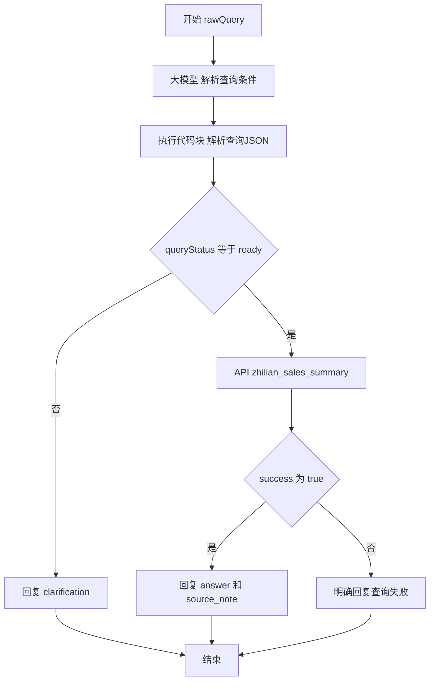

# 智链销销售查询意图流接手资料

用于接手 YonBIP「智链销-销售查询」智能体及「销售数据查询」意图流的搭建工作。资料整理日期：2026-10-22。

**这是代码、提示词、截图和实施说明的交接仓库，不是 YonBIP 导出的意图流文件，不能直接导入平台。当前未取得整条流程调用真实 API 成功的验证记录。**

## 接手先看

1. [当前状态与剩余工作](docs/HANDOFF.md)
2. [节点及变量绑定表](docs/WORKFLOW.md)
3. [已观察到的 API 契约与待确认项](docs/API.md)
4. [模型系统提示词](prompts/query-parser-system.txt)和[用户提示词](prompts/query-parser-user.txt)
5. [解析节点原始代码](src/parse-query.js)
6. [本地测试](tests/parse-query.test.cjs)

## 当前状态

| 部分 | 可确认情况 |
|---|---|
| 智能体 | 用户截图显示「智链销-销售查询」，已挂接 zhilian_sales_summary API 服务 |
| 意图流 | 用户已创建「销售数据查询」，开始节点输入 rawQuery 为 string |
| 大模型节点 | 已配置解析提示词；模型截图为 Qwen3.7-Max；输出 output 为 string |
| 解析代码 | 用户随后反馈「可以了」，截图显示八个业务输出字段及平台 errorMsg；未提供成功运行的具体输入输出 |
| 条件分支 | 已指导设置 queryStatus == ready，用户报告变量已出现；最终保存状态需现场核对 |
| API 节点 | 已选中 zhilian_sales_summary；截图仍有固定日期与 metric=sales，输入变量是否全部替换需核对 |
| 失败回复与结束节点 | 尚未确认完成 |
| 全流程调试、发布、关联智能体 | 尚未确认完成 |

## 目标流程



## 本地检查

需要 Node.js 18 或以上，仅使用内置模块，没有 npm 第三方依赖。

```sh
npm test
```

测试用于验证 JavaScript 解析与校验逻辑；不验证 YonBIP 的运行环境、节点配置、变量作用域、API 可达性或 API 业务口径。

## 平台入口

- 新道云门户：https://edu.seentao.com/portal_web/index
- 课程学习：https://edu.seentao.com/runner_web/student/index
- BIP：https://bipv5.seentao.com/
- 官网：https://cloud.seentao.com

用户从新道云课程学习中的「进入系统」进入 BIP。接手人员优先沿用户课程入口登录并进入同一课程/租户。不要仅凭主页地址假定已进入同一个租户。

本会话中的可操作浏览器访问上述站点均在登录页加载前遇到 ERR_CONNECTION_CLOSED。没有在网页中实际完成搭建或修改；不能据此推断用户本机也存在同样网络问题。

## 文件范围

- `src/`：供复制到平台执行代码块的 main(params) 函数。
- `prompts/`：模型解析提示词。
- `docs/`：接手清单、API 与流程说明、历史参考方案。
- `screenshots/`：不包含鉴权值的界面截图，用于定位节点。
- `reference-documents/`：本会话的签到表及赛事原始材料，供完整交接；不是代码运行所需依赖。

截图中曾出现 API 鉴权值，包含该值的原始 API 配置截图未入库。仓库不包含登录凭据、Cookie、Token、真实接口地址或平台导出配置。接手人员须从平台已有授权配置或仓库所有者处获取必要访问条件。
