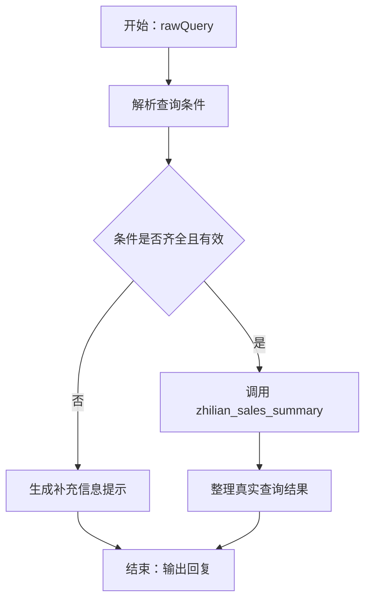

# 销售数据查询意图流搭建参考

这是供照着配置的参考方案，尚未写入 YonBIP。截图可确认开始节点输入为字符串 rawQuery，已有 API 服务名称为 zhilian_sales_summary；其余节点类型、API 入参和返回结构需按你的实际配置对应。

## 一、先按这个顺序连接



保留画布中的“开始”“结束”，在中间添加上述功能节点。点击左下角“添加节点”，按实际菜单选择能完成大模型处理、条件判断、API 调用的节点。图中的名称是建议的节点名称，不代表平台菜单的原名。

缺少条件的分支先提示用户重新提供完整问题并结束本次运行。例如：“请补充查询期间和商品范围，如：查询2026年10月全部商品的销售汇总。”这样不依赖尚未配置的跨轮记忆。

## 二、开始节点

保留已有输入：

| 输入名称 | 类型 | 用途 |
|---|---|---|
| rawQuery | 字符串 | 用户提出的完整销售查询问题 |

第一轮测试输入：

```text
查询2026年10月1日至10月20日全部商品的销售额、报表退货额和净销售额。
```

## 三、解析查询条件

建议节点名称：解析查询条件。

把“开始.rawQuery”通过平台的变量选择器绑定为该节点输入。下文 rawQuery 是输入变量名，不是需要原样提交的固定查询文本。

可复制提示词：

```text
你是销售查询条件解析器，只提取查询条件，不生成或推测经营数字。

从输入 rawQuery 中识别查询期间、商品范围、商品名称和用户需要的查询内容。

规则：
1. 返回严格 JSON，不输出解释或 Markdown 标记。
2. startDate、endDate 使用 YYYY-MM-DD。明确到整个月且包含年份时，转换为该月首日和末日。
3. 缺少年份、日期含糊、起始日期晚于结束日期时，不猜测，设置 needClarification=true。
4. 第一版不处理“最近”“本月”等相对日期；遇到这类表达，请用户提供明确的起止日期。
5. 用户明确要求全部商品时，productScope="all"，productName=""。
6. 用户指定商品名称时，productScope="specific"，productName 保留原始商品名称，不虚构商品编码。
7. 用户没有说明商品范围时，productScope="unknown"，设置 needClarification=true。
8. queryContent 原样概括查询需求，不猜测 API 可支持的指标或查询方式。
9. 条件不足时，clarification 说明需要补充什么，并请用户重新发送包含完整查询期间和商品范围的问题；条件齐全时 clarification=""。
10. 无法确定的日期字段用空字符串，不自行补齐。

输出格式：
{
  "startDate": "",
  "endDate": "",
  "productScope": "unknown",
  "productName": "",
  "queryContent": "",
  "needClarification": true,
  "clarification": ""
}
```

上面六个字符串字段和一个布尔字段是本参考方案自定义的内部输出，不是已确认的 API 参数。若平台支持结构化输出，将它们分别配置为输出字段；若只返回文本，需要用平台提供的 JSON 解析能力取出字段，再连接条件判断。

第一轮测试的预期解析结果：

```json
{
  "startDate": "2026-10-01",
  "endDate": "2026-10-20",
  "productScope": "all",
  "productName": "",
  "queryContent": "查询销售额、报表退货额和净销售额",
  "needClarification": false,
  "clarification": ""
}
```

## 四、条件判断与补充提示

建议判断名称：查询条件检查。

| 条件 | 后续连接 |
|---|---|
| needClarification 为 true | 补充信息提示 |
| needClarification 为 false，且起止日期非空、productScope 为 all 或 specific | 销售数据查询 API |
| 解析失败或字段缺失 | 补充信息提示，不调用 API |

“补充信息提示”输出解析节点的 clarification。若解析失败没有可用的 clarification，输出：

```text
请提供明确的起止日期和商品范围。例如：查询2026年10月1日至10月20日全部商品的销售汇总。
```

将这段提示送至结束节点。若界面只允许一种节点产生回复，可用一个大模型节点接收 clarification 并原样输出。

## 五、调用已有 API

建议节点名称：销售数据查询。

选择已有服务 zhilian_sales_summary。这里必须先查看服务真实入参，下面只是绑定原则，不能直接把左侧说明当作接口字段名填写。

| API 中的实际入参含义 | 建议绑定来源 |
|---|---|
| 查询原文（若 API 只接受查询文本） | 开始.rawQuery |
| 开始日期（若存在） | 解析查询条件.startDate |
| 结束日期（若存在） | 解析查询条件.endDate |
| 商品名称（若存在） | 解析查询条件.productName |
| 商品编码或商品 ID（若接口要求） | 先查询商品主数据得到真实值，不能直接填商品名称或让模型编造 |

需要核对：

1. 全部商品究竟通过省略参数、空字符串、专用枚举还是其他值表达，按接口定义设置。
2. 日期格式与结束日期是否包含当天，按接口定义转换；本参考中的 endDate 表示用户希望包含的最后一天。
3. 是否还必需租户、组织、门店等参数，使用已授权的真实配置；不能只根据这张截图补写。
4. 汇总与明细是否都受该服务支持。未提供的查询能力不能靠提示词补出来。
5. 调用失败应输出失败提示；如果节点支持异常分支，将它连接至失败回复后结束。不要假设失败一定会以普通返回值传到后续节点。

若暂时不知道这些字段，可先把其他节点搭好，保留 API 绑定待核对，不要填写猜测值。

## 六、整理查询结果

建议节点名称：整理查询结果。

建议输入（使用实际变量选择器绑定）：

| 自定义输入名 | 来源 |
|---|---|
| rawQuery | 开始节点的原始问题 |
| queryConditions | 解析查询条件节点的结构化结果 |
| apiResult | API 节点真实返回内容 |

可复制提示词：

```text
你是销售数据查询结果整理助手。
根据输入 rawQuery、queryConditions、apiResult 回答用户，只能使用本次 API 实际返回的数据。

规则：
1. 先说明查询期间和商品范围，再列出接口实际提供的销售指标。
2. 不得根据示例、常识、历史对话或空白字段编造任何经营数字。
3. API 明确返回的零值可以显示为0；字段缺失或为空时写“接口未返回”，不能替换成0。
4. API 明确返回无匹配记录时，回复“该查询条件下未找到匹配记录”，不等同于零销售。
5. 净销售额不代表净利润，报表退货额不代表已实际退款。
6. 优先使用接口返回的净销售额。只有销售额、报表退货额及其口径均已确认一致时，才可按“净销售额=销售额-报表退货额”计算，并标明为计算值。
7. 保留接口明确提供的单位与币种；未提供时，不自行认定为元或人民币。
8. 只有接口实际返回销售明细时才展示明细；只有汇总时，说明本次仅返回汇总。
9. 接口返回失败或不可用时，明确说明未取得数据，不声称查询成功。
10. 不扩展到利润、库存、采购执行或经营建议。

按实际数据使用以下结构，未返回的指标明确标注，不预填数字：
查询期间：
商品范围：
销售额：
报表退货额：
净销售额：
明细或数据说明：
```

将该节点的文本输出命名为 answer（或使用平台实际输出字段名）。

独立的 API 调用失败分支可直接输出：

```text
本次销售数据查询失败，尚未取得真实经营数据，请稍后重试。
```

## 七、结束节点

成功路径：把“整理查询结果”的真实文本输出绑定到结束节点的输出或回答模板。

缺少信息路径：绑定“补充信息提示”的文本输出。

调用失败路径：绑定明确的失败提示。

通过界面变量选择器插入对应节点输出，不要把“整理查询结果.answer”当成普通文字填写，也不要预填虚构销售金额。如果平台不支持多条路径共用结束节点，按实际节点能力设置各路径的终点。

## 八、按这五条测试

| 测试问题或条件 | 应有结果 |
|---|---|
| 查询2026年10月1日至10月20日全部商品的销售汇总 | 条件解析成功，使用真实绑定参数调用 API |
| 查询全部商品的销售额 | 提示补充明确的查询期间，不调用 API |
| 查询2026年10月1日至10月20日的销售额 | 提示补充商品范围，不调用 API |
| 查询2026年10月20日至10月1日全部商品的销售额 | 指出日期顺序有误，不调用 API |
| 在测试环境模拟 API 返回失败或无匹配记录 | 分别显示失败或无匹配记录，不编造数字、不将缺失字段写成0 |

先保存并使用截图右上角的“调试验证”检查。确认变量传递、API 调用和回复均符合预期后，再使用正式发布功能。

完整配置还需查看“添加节点”菜单、zhilian_sales_summary 的入参及返回结构，才能把本参考方案对应到你这版平台的实际字段。
